<div align="center">


# 物理實驗室 · 台灣中學互動物理

**看得見的物理，可以動手玩的實驗室**

從國中自然的生活物理，銜接到 108 課綱高中物理與大學入門的互動模擬網站

[](https://senior-science.vercel.app/)
[](https://senior-science.vercel.app/experiments.html)
[](#curriculum)
[](#curriculum)
<br>
[](https://github.com/Yu-0312/senior-science/actions/workflows/deploy.yml)
[](#architecture)
[](#features)
[](#license)

[**🌐 線上使用**](https://senior-science.vercel.app/) ·
[🧑‍🏫 教師演示版](#teacher) ·
[📖 自學完整版](#student) ·
[🎮 關卡挑戰版](#duo) ·
[🔬 實驗一覽](#gallery) ·
[🛠️ 開發者](#architecture)

<br>

<picture>
  <source media="(prefers-color-scheme: dark)" srcset="docs/images/hero-dark.webp">
  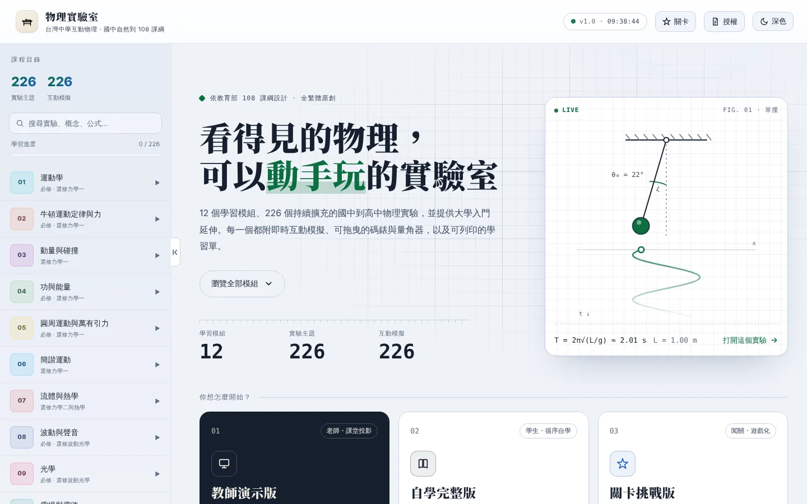
</picture>

</div>

全站繁體中文，涵蓋國中基礎、必修物理與選修物理加深加廣內容，目前提供 **12 個學習模組、226 個實驗主題、226 個即時 Canvas 互動模擬**；目錄採資料驅動擴充，沒有預設的實驗或題型數量上限。純靜態網站、沒有後端、不需要帳號——打開就能用。

| | |
| --- | --- |
| 🌐 **線上網站** | [https://senior-science.vercel.app/](https://senior-science.vercel.app/) |
| 📋 **全部實驗索引** | [experiments.html](https://senior-science.vercel.app/experiments.html)（每個實驗都有說明頁與可列印學習單） |
| 📜 **使用授權** | [免費教育使用與推廣授權](https://senior-science.vercel.app/licensing.html) |

---

<a id="principles"></a>

## 💡 設計原則

這個專案有一條貫穿全部 226 個實驗的判準：

**每一根滑桿都必須讓學生看見一個他能解釋的改變。**

如果拉了滑桿只有數字在跳，或者畫面上有東西在動但學生說不出它為什麼動，那個實驗就還沒做完——它只是一段不知名的動畫。由此衍生出幾件具體的事：

- **參數推到極端時，模擬要以有意義的方式壞掉**。過山車高度不夠就真的在 N = 0 的位置脫軌，而不是硬滑過去；電流超過額定時燈泡會燒斷，裝了保險絲則保險絲先斷。
- **看不見的量要畫出來**。槓桿把力臂用標註線從支點量到懸掛點，重量用長度正比於 W 的箭頭表示；打點計時器的點是小車跑的時候一顆一顆被打出來的，不是一開始就畫好。
- **先預測再操作**。進入實驗會先問一題方向預測，作答後才用模型的真實數據揭曉。先承諾一個答案，操作時才會真的在「檢查」。
- **物理關係由程式量出來，不是寫死的**。探測引擎掃描每個實驗的滑桿與讀數，用對數迴歸求冪次——單擺會自己得出 T ∝ √L 與「振幅不影響週期」。

---

<a id="modes"></a>

## 🧭 三種使用方式

首頁的三張入口卡進入的是同一批實驗、同一套模擬，差別在畫面給誰用。

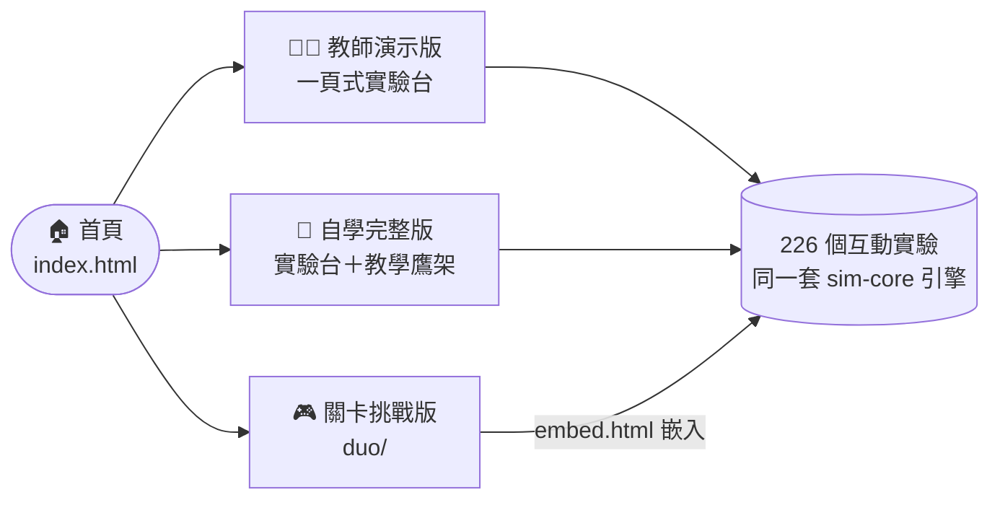

| | 🧑‍🏫 教師演示版 | 📖 自學完整版 | 🎮 關卡挑戰版 |
| --- | --- | --- | --- |
| 給誰 | 老師上台投影 | 學生自己讀 | 學生闖關、課堂練習 |
| 畫面 | 一頁式實驗台，整頁與右欄都不捲動 | 實驗台＋完整教學鷹架 | 多鄰國式地圖，一個實驗一關 |
| 入口 | 首頁「教師演示版」 | 首頁「自學完整版」 | `duo/` |

<a id="teacher"></a>

### 🧑‍🏫 教師演示版：一頁式實驗台

<picture>
  <source media="(prefers-color-scheme: dark)" srcset="docs/images/teacher-dark.webp">
  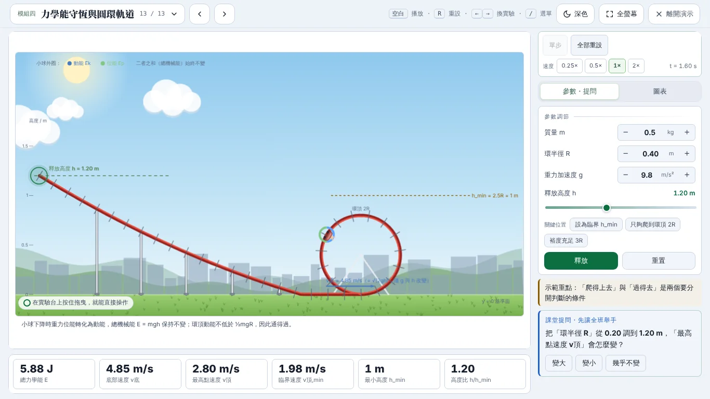
</picture>

- **整頁、右欄都不捲動**：1280×720、1366×768、1920×1080 下，226 個實驗都用 `node tools/stage-fit-check.js` 在真的瀏覽器裡逐一確認——整頁不捲、右欄每個分頁都放得下。畫布高度由 `app.js` 的 `fitStage()` 依扣掉讀數列後的實際空間計算，而不是用 CSS 壓扁。
- **量測讀數在畫布正下方**：橫排一列、字放大給後排看。畫布多半是寬的，下面本來就空一截。
- **右欄**：播放控制 → 情境預設 → 參數 → 圖表 → 示範重點 → 課堂提問（把「先預測」題改成讓全班舉手）。放得下就全部攤開；放不下依序縮小圖表、分成「參數｜圖表｜提問」分頁、收緊間距與字級，參數特別多的實驗右欄加寬、參數排兩欄。
- **演示列**：可搜尋的實驗選單（顯示在模組中的第幾個）、上一個／下一個、深淺色切換（投影機偏暗時用淺色）、全螢幕、離開。換實驗不必回首頁。
- **鍵盤**：`空白` 播放／暫停、`S` 單步、`R` 全部重設、`←` `→` 換實驗、`1` `2` `3` 切右欄分頁、`/` 開選單、`F` 全螢幕、`Esc` 離開。
- 老師切換實驗時不會跳出學生用的章節檢核。

右欄怎麼決定要不要分頁（`app.js` 的 `fitStage()`）：每一步都會先試「收緊間距」、再試「收緊字級」，取第一個每個分頁都放得下的方案。

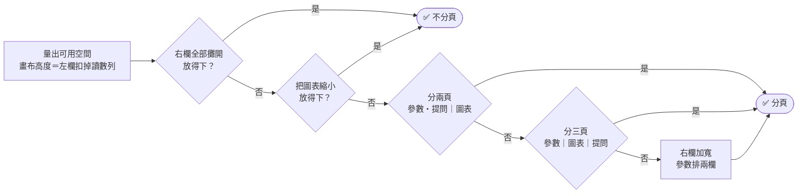

<a id="student"></a>

### 📖 自學完整版

<picture>
  <source media="(prefers-color-scheme: dark)" srcset="docs/images/student-dark.webp">
  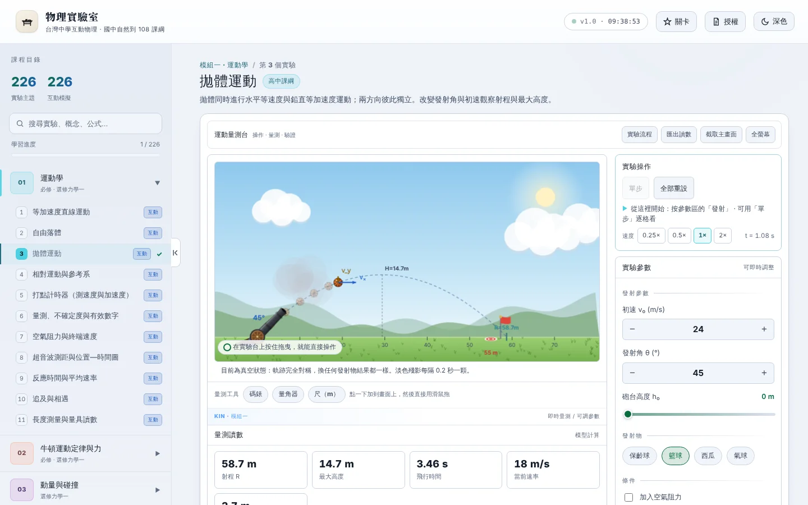
</picture>

一個實驗的學習循環：

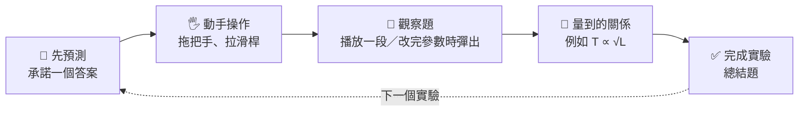

保留全部鷹架：任務導讀、實驗流程（可逐步推進）、先預測、挑戰任務、量到的關係、因果面板、題目練習、課本銜接、一句話結論與學習單。首頁的學習中心負責存檔匯出／匯入、學習計劃與今日任務。

- **觀察題在實驗進行中彈出**（`sim-observe.js`）：每個實驗都有兩個階段會停下來問一題——播放到一個段落（或這一輪自己跑完）時，問「剛才某個讀數是怎麼變的」；暫停中改了一根滑桿、放手之後，問「哪個讀數怎麼變了」。答案一律來自當下量到的讀數，不是套樣板。觀察卡停靠在角落，答題時看得到實驗台。18 個實驗另有手寫的關鍵時刻觀察點。
- **完成實驗 · 總結題**：原本放在右側教材欄的題目練習移到實驗台下方，做完觀察再作答；教材欄改放「實驗進度」清單（播放觀察 → 改變參數 → 總結題）。
- **版面平衡**（`sim-core.js` 的 `arrangeStage`）：因果面板一律移到實驗台正下方橫排；右欄比畫布長一大截時，自動把讀數、任務導讀、先預測或因果說明搬進畫布卡底部，取兩欄高度差最小的組合。畫布永遠維持原比例——試過讓畫布長高去填空白，場景會被拉開、重心跑掉。

<a id="duo"></a>

### 🎮 關卡挑戰版（`duo/`）

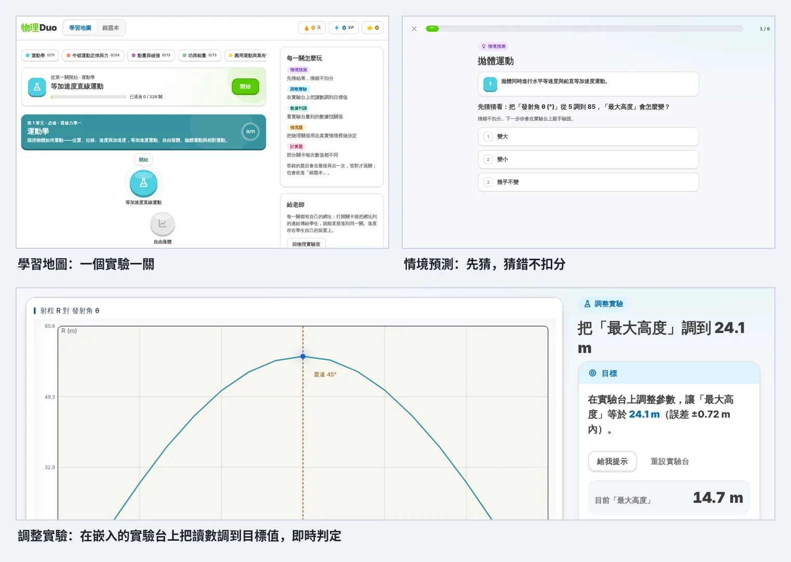

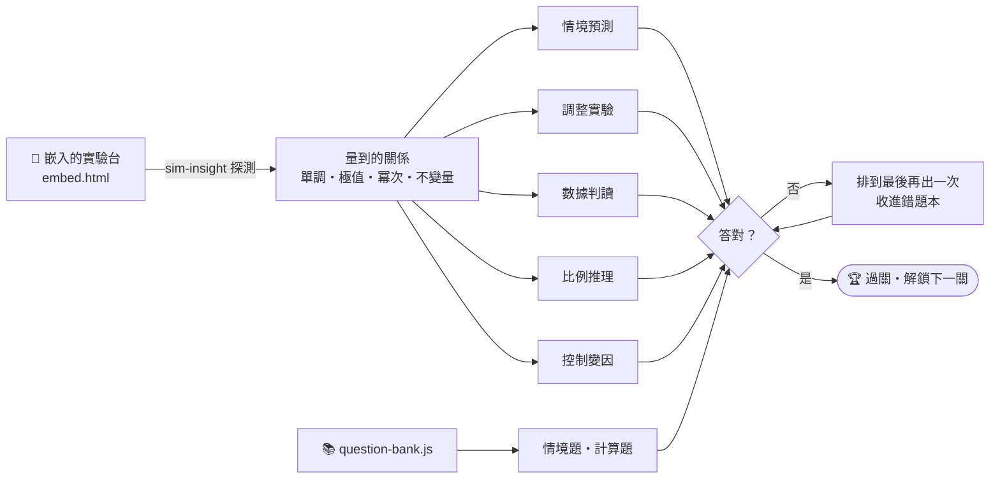

每個實驗是一關。題目不是預先寫好的樣板，而是關卡開始時由**這一關的實驗台實際量到的關係**產生（`sim-insight` 的探測結果經 `duo/embed.html` 的 `window.DuoLab` 交給外層）：

| 題型 | 做什麼 | 來源 |
| --- | --- | --- |
| 情境預測 | 先猜「把 X 從 a 調到 b，Y 會怎樣」，猜錯不扣分，做完實驗再揭曉 | 探測到的主關係 |
| 調整實驗 | 在嵌入的實驗台上把讀數調到目標值（例如「把週期 T 調到 5.5 s」），即時判定；有三層提示 | 探測到的單調或有極值的關係 |
| 數據判讀 | 表格數字由模型算出；判斷正比／反比／平方關係，或推估中間值 | 探測掃描的取樣點 |
| 比例推理 | 「X 變 4 倍，Y 變幾倍？」 | 擬合出的冪次（R² > 0.995 才出題） |
| 控制變因 | 找出完全不影響 Y 的那個參數 | 多工作點複驗過的不變量 |
| 情境題 | 把關係放進需要做決定的情境；以及題庫逐題撰寫的題目 | 探測結果、`question-bank.js` |
| 計算題 | 每次數值都不同 | `question-bank.js` 的 numericBank |

答錯的題目會排到最後再出一次，答對才過關，並收進「錯題本」。進度存在學生自己的瀏覽器（`localStorage` 的 `duo2-state`）。每一關有自己的網址（`duo/#實驗id`），老師可以直接把某一關傳給學生。

關卡版是原生 JS，不需要建置，直接使用主站的 `js/` 與 `css/`——以前在 `duo/lab/` 放的一整份複本已移除，改主站的實驗就等於改了關卡版。

---

<a id="gallery"></a>

## 🔬 實驗一覽

每個實驗都換成認得出來的器材與情境；淺色主題是白天、深色主題是夜晚（GitHub 會依你的系統主題顯示對應的版本）。

<picture>
  <source media="(prefers-color-scheme: dark)" srcset="docs/images/gallery-dark.webp">
  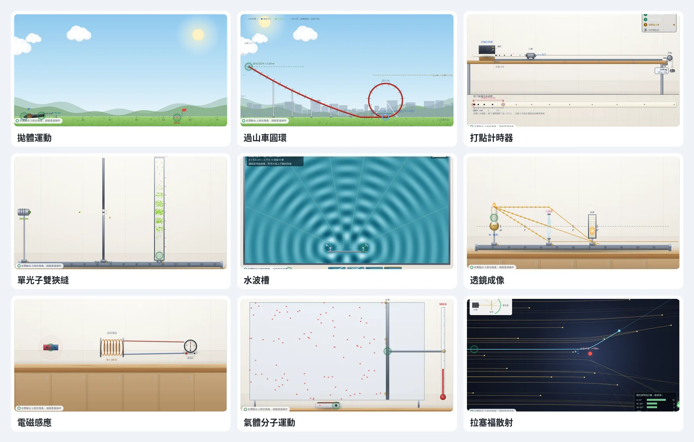
</picture>

### 📱 手機也能用

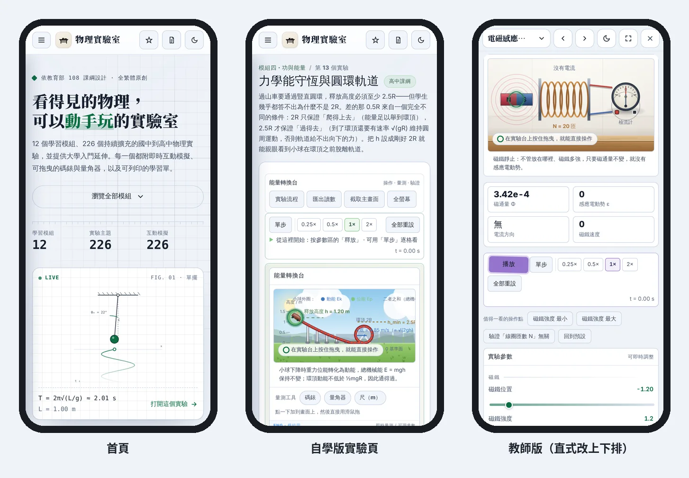

---

<a id="features"></a>

## ✨ 專案特色

### 🧑‍🔬 教學設計

- **每個實驗都有符合它自身內容的教學鷹架**：判定徽章（現在這個狀態代表什麼）、衍生量卡（介於參數與答案之間的中間量）、因果面板（為什麼會這樣）、實驗流程與誤差鐵律、情境預設（一鍵跳到有教學意義的設定）。不是每個實驗都套同一組——量具實驗需要的是讀數規則，力學實驗需要的是受力分析。
- **實驗室的標準流程與誤差鐵律**：16 個實體實驗附上真實的操作動線與最容易整組報廢的那一步。例如打點計時器的「先啟動計時器、再放開小車」，單擺的「擺長要量到球心不是球頂」，槓桿的「沒先空桿調平，每一組數據都會偏向同一邊」。
- **量測—作圖—求斜率的必做實驗**：單擺測 g、彈簧測 k、斜面測 μs、導線電阻率、溫度對電阻、牛頓冷卻、透鏡焦距、共鳴管測聲速，全部採「改變變因 → 記錄資料點 → 線性擬合 → 由斜率求物理量 → 比對誤差」的動線，並可開啟量測誤差觀察最小平方法如何收斂散點。
- **可驗證的挑戰任務**：自動產生具體目標（「讓條紋間距達到 4.10 mm」），即時判定達成，讓實驗有明確的「做完了」。
- **章節檢核與隨機化計算題**：跨模組時以 3 題整理上一章；計算題每個學生、每一天拿到的數值都不同，必須實際算出來作答。

### 🚀 旗艦實驗

- **可以瞄準的拋體**：四種發射物（保齡球到氣球，質量差 140 倍）、可移動的靶與命中回饋。打開空氣阻力後軌跡不再對稱、最遠角度從 45° 降到 40°，而且質量突然變得有影響——真空版本永遠看不到的事。
- **打點計時器**：計時器固定在桌上，小車拉著紙帶前進，每個週期打點錘落下閃一次。下方是取下攤平的紙帶，點逐一出現並標註點距。開始前紙帶上有一排淡色的預測點。
- **過山車圓環**：h ≥ 2.5R 幾乎每個學生都背得出來，但「為什麼不是 2R」答不上來。「爬得上去」和「過得去」是兩個不同條件，模擬把動能裕度 ΔEk = mg(h − 2.5R) 直接攤出來，不足時在真正的脫軌角度離開軌道。
- **追及與相遇**：「後車比前車快，遲早追上」只對了一半。前車剎停後你遲早追得上；前車在加速，速度相等的那一刻若還沒追上就永遠追不上了。x−t／v−t／Δx−t 三張圖分頁呈現，間距的極值就落在 v 相等的那一刻。
- **游標卡尺與螺旋測微器**：游標不估讀、測微器必估讀，以及螺旋測微器的半毫米陷阱——這三條讀數規則是實驗課真正會扣分的地方。
- **證明「變化率才會發電」的電磁感應**：磁鐵停在線圈正中央時磁通量最大，但電動勢是零。Φ 與 ε 並列，山頂的斜率為零這件事用看的就懂。
- **壓力真的被撞出來的氣體實驗**：壓力讀數不是用 PV = nRT 算的，而是統計分子實際撞擊活塞的動量變化。等溫壓縮時 P×V 守恆，升溫時速率分布自己長成馬克士威分布。
- **單光子的雙狹縫**：把每秒光子數調到 1，前 20 顆完全隨機；累積數百顆後干涉條紋自己浮現。在縫上裝偵測器——一旦知道光子走哪一條，條紋立刻消失。
- **會產生音爆的都卜勒**：把速度推過 340 m/s，波前來不及散開而疊成馬赫錐——超音速時前方在它經過之前完全聽不到。

### 🖥️ 介面與可用性

- **完整實驗工作台**：實驗參數、即時量測、專題化 Canvas 場景、資料／圖表與可展開的實驗流程。
- **可拖曳的量測工具**：碼錶、量角器與（已校準比例尺的實驗才提供的）尺。碼錶量的是模擬時間，慢動作與單步都會正確計入，學生能自己量出單擺週期再和公式對照。
- **進場就在動，滑鼠直接在實驗台上操作**：光在走、電流在流、波在傳、指針在擺這類「穩態」畫面（約 120 個實驗）進場就自動播放；拋射、碰撞、釋放等一次性事件仍等學生按開始，保留「先預測再觀察」。全站 225 個實驗都有畫布把手，而且不必點中圓圈——在實驗台上任何地方按下，會抓起附近最近的把手，滑鼠靠近時游標變成手掌並亮起將被抓的物件。系統設定「減少動態」時不自動播放。
- **每個實驗都會動，而且能直接動手**：按下播放後，光點沿光路前進（進入玻璃後變慢、間距變短）、電荷沿導線流動（速率與電流成正比，惠斯登電橋平衡時檢流計支路停住）、彈簧與天平先晃一陣才停在平衡、電表指針阻尼擺到讀數。畫面上的圓形把手可以直接拖：轉雷射筆改入射角、推蠟燭改物距、移動滑片、把砝碼往下拉再放手。把手背後就是原本的滑桿，讀數、圖表、關卡判定全部同步，也可以用鍵盤方向鍵操作。
- **時間控制列**：播放／暫停、單步前進 1/60 秒、0.25×～2× 慢動作、一鍵全部重設。碰撞瞬間與波的相位用單步逐格檢查最清楚。實驗本身不自備播放鍵——兩個開關要同時打開的話，學生看不出為什麼按了沒反應。
- **進場不自動播放**：依 PhET 訪談結論停在第一格並提示播放鍵，讓學生先觀察再動手。暫停時調整滑桿一樣會即時重繪。
- **深色／淺色主題**：兩種主題的文字與圖形色彩皆通過 WCAG AA 對比檢查。
- **主題感知的繪圖層**：模擬畫布依背景亮度自動決定墨色——寫死的白色線條在淺色主題自動轉為深墨，主題本身選定的表面色則原封不動放行，半透明色會依合成後的實際對比調整。
- **步進器與選項晶片也會即時重繪**：「− 數值 +」步進器與選項晶片是按鈕，原本不會觸發引擎的暫停重繪；現在數值改變時補發 `input` 事件，暫停狀態下按一下就看得到變化（`control-response-test` 同時檢查滑桿、步進器與晶片）。
- **手機優先**：以 `pointer: coarse` 判斷觸控裝置，滑桿、按鈕與清單項目均達 WCAG 2.5.5 的 44px；量角器與尺在觸控時命中範圍加倍。實驗頁在窄螢幕改為「預測 → 播放 → 模擬台 → 讀數」，畫布前的內容高度減少 71%。
- **螢幕報讀器可用**：每個模擬的畫布都有隨狀態更新的文字描述，另附「文字版讀數」對照表與 `aria-live` 播報。
- **延遲載入**：實驗程式開啟時才載入。首次載入 gzip 約 **236 KB**（上限 240 KB 由 `perf-test` 把關）；26 個實驗檔合計 gzip 約 560 KB 不在其中，打開單一實驗最多再載 40 KB。
- **PWA 與離線**：可安裝到主畫面；Service Worker 只預先快取核心，實驗程式開到才快取。需要完整離線時可主動下載全部實驗，有進度回報。
- **可被搜尋引擎索引的靜態層**：`tools/build-static.js` 由課程資料自動產生 226 個實驗說明頁、226 份可列印學習單、總索引頁、`sitemap.xml` 與 `robots.txt`，並附結構化資料（schema.org LearningResource）。
- **給老師的可列印學習單**：每個實驗一張，含實驗目的、關鍵公式、動手前預測、資料記錄表格、方格作圖區、由圖求值與誤差欄位。

---

<a id="curriculum"></a>

## 📚 課程內容

| 編號 | 模組 | 實驗數 | 代表實驗 |
| --- | --- | ---: | --- |
| 一 | 運動學 | 11 | 等加速度直線運動、拋體運動、打點計時器、追及與相遇、終端速度、游標卡尺與螺旋測微器 |
| 二 | 牛頓運動定律與力 | 24 | F = ma、斜面外力與摩擦、桌面—懸掛連接體、輸送帶、阿特午機、力矩平衡、滑輪、桁架橋、斜面法測 μs |
| 三 | 動量與碰撞 | 13 | 一維與二維碰撞、衝量、彈道擺、質心、火箭與多級火箭、水火箭、緩衝區 |
| 四 | 功與能量 | 13 | 功能定理、力學能守恆、保守力、功率與效率、水力與風力發電、過山車圓環 |
| 五 | 圓周運動與萬有引力 | 11 | 向心力、錐動擺、角動量守恆、轉動慣量、鉛直圓周、克卜勒定律、人造衛星、卡文迪西扭秤 |
| 六 | 簡諧運動 | 11 | 彈簧振子、單擺、阻尼、共振、耦合振子、物理擺與扭擺、單擺測 g、彈簧測 k |
| 七 | 流體與熱學 | 24 | 浮力、白努利、理想氣體、熱力學第一定律、相變、熱傳導、四行程引擎、布朗運動、U 形管、比熱 |
| 八 | 波動與聲音 | 20 | 水波槽、疊加與干涉、聲波干涉、駐波、都卜勒、拍、共鳴管、真空鐘罩、地震波定位 |
| 九 | 光學 | 28 | 司乃耳定律、平面鏡、視深、透鏡成像、雙縫干涉、單狹縫繞射、布魯斯特角、光纖、菲涅耳繞射 |
| 十 | 電場與電路 | 30 | 摩擦起電、庫侖定律、等位線描繪、電位、平行板電容器、伏安法、電動勢與內電阻、RC 充放電、惠斯登電橋、自由接線電路工坊、RLC 共振、電阻率 |
| 十一 | 磁場與電磁感應 | 25 | 螺線管磁場、電磁波譜、勞侖茲力、法拉第與楞次定律、發電機與變壓器、質譜儀、霍爾效應、渦電流、直流馬達、迴旋加速器 |
| 十二 | 近代物理與宇宙學 | 16 | 原子結構、波耳氫原子、物質波、X 射線管、質能守恆、連鎖反應、光電效應、半衰期、密立根油滴、拉塞福散射、黑體輻射、陰極射線、光譜、蓋革計數 |
| | **合計** | **226** | |

### 🪜 銜接式學習設計

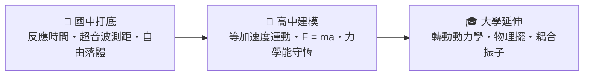

首頁提供五條可直接操作的主題路徑。每條都保留「國中打底 → 高中建模 → 大學延伸」三個固定階段，並在路徑中的實驗頁顯示前一步與下一步。大學內容不是額外跳關，而是建立在同一路徑的既有觀察、量測與公式之上。

| 主題路徑 | 國中打底 | 高中建模 | 大學延伸 |
| --- | --- | --- | --- |
| 運動與力 | 反應時間、超音波測距、自由落體 | 等加速度運動、F = ma、力學能守恆 | 轉動動力學、物理擺、耦合振子 |
| 熱與能量 | 氣體定律、比熱、相變、熱機原理 | 熱力學第一定律、熱傳導、熱量計 | 導熱棒與熱傳導率、牛頓冷卻定律 |
| 波動與光 | 橫波與縱波、聲音三要素、針孔成像 | 疊加與干涉、駐波、雙縫干涉、單狹縫繞射 | 弦的諧波、菲涅耳繞射 |
| 電與磁 | 歐姆定律、串並聯、載流導線的磁場 | 電容充放電、電磁感應、RLC 共振 | RC 低通頻率響應、畢奧－沙伐定律 |
| 光、原子與量子 | 原子結構、色光三原色、色散、最小偏向角 | 光電效應、發射光譜、密立根油滴、波耳氫原子、物質波、質能守恆 | 拉塞福散射、蓋革計數與隨機誤差 |

學測／分科常考與國中銜接的 23 個實驗收在 `js/exam-curriculum.js`，每筆多一個 `exam` 欄位：`tag` 是課本出處（例如「選修物理IV 實驗：等位線與電場」），顯示在實驗標題旁；`how` 是「考題怎麼問」，顯示在教材區。新實驗也同步接進上表的銜接路徑。

### 🗂️ 內容擴充歷程

| 批次 | 焦點 |
| --- | --- |
| 一、二 | 核心課綱 120 個實驗 |
| 三 | 實驗方法（最小平方法、殘差、變因控制、不確定度傳遞、量綱分析）與工程應用 |
| 四 | 國中銜接與完整實驗鏈：從日常現象建立模型，每個新主題都有自己的互動場景 |
| 五 | 開放式量測台與無預設數量上限的目錄 API |
| 六 | 大學先修：拉格朗日量、相空間、熵增加、傅立葉頻譜、菲涅耳繞射、量子位阱 |
| 七 | 教學鷹架全面補齊、旗艦實驗改版、21 支自動化稽核 |
| 八 | 實物場景改版：每個實驗都換成認得出來的器材與情境（平拋用大砲、壓力用雪地腳印、回聲用蝙蝠），淺色主題是白天、深色主題是夜晚；移除 49 個無法在實驗室動手做的純概念主題 |
| 八之二 | 逐一檢查剩下偏空的畫面：勞侖茲力改成亥姆霍茲線圈＋發光球管（並修正轉向）、質譜儀修正落點與偏轉方向、楞次定律加檢流計、電容器接成實物 RC 電路、拉塞福散射改成暗色放大視窗、共鳴管畫出空氣分子縱向振動（並修正開管的節腹）、向心力改成課本的向心力實驗器、甩水桶、打點計時器、繞射光具座、串並聯接上電表；並檢查側邊控制列的窄畫面版面 |
| 九 | 介面改版與三種使用方式：首頁「實驗筆記本」設計、教師版一頁式實驗台與演示列、移除重複按鈕、關卡挑戰版以原生 JS 重寫並由實驗台量到的關係出題 |
| 九之二 | 深度除錯：步進器暫停時不重繪（16 個）、關卡調整題有 52 題調不到、學習單在手機上橫向溢出、教師版在直式畫面擠壞、等加速度實驗的圖表在手機被裁切、畫布讀數小卡寬度寫死 |
| 十之二 | 學測／分科與國中銜接：新增 23 個實驗（克卜勒定律、人造衛星、錐動擺、水波槽、聲波干涉、真空鐘罩、視深、平面鏡、布魯斯特角、四行程引擎、布朗運動、電磁波譜、等位線描繪、電位地形、平行板電容器、摩擦起電、螺線管磁場、原子結構、波耳氫原子、物質波、X 射線管、質能守恆、連鎖反應），每個附課本出處標籤、「考題怎麼問」與 3 題學測風格題目；穩態動畫進場自動播放；畫布任意處拖曳就近抓把手 |
| 十 | 全站動態化：盤點出 62 個按播放後畫面不動的實驗（光學只有一張光路圖、電路只有指針、靜力平衡只有受力圖），逐一補上有物理意義的動態，並加上畫布拖曳把手。順手修正：色散角讀數原本寫死 14.3°（改用 F2 火石玻璃的真實色散）、雙凸透鏡位移法光路畫錯、迴圈軌道按「釋放」不會動、摩擦力實驗每 20 m 瞬移回原點、桁架橋撓度方向相反。沒有實驗需要移除 |

---

## 🚀 快速開始

### 線上使用

[https://senior-science.vercel.app/](https://senior-science.vercel.app/)

本站完全公開，不需要密碼；它是純靜態網站，沒有後端，也沒有任何存取控制。

### 本機使用

互動模擬本身可在 `file://` 執行，但 MathJax 排版與 PWA 快取需要 `http://`：

```bash
python3 -m http.server 8080   # 然後開 http://localhost:8080
```

---

## 🧪 測試

在**專案根目錄**執行：

```bash
node tools/tests/run-all.js          # 全部（約 1 分鐘）
node tools/tests/run-all.js --fast   # 略過兩支耗時稽核
```

22 支稽核守著不同的東西：226 個實驗在兩種主題下都能建置與重繪、核心實驗對照封閉解、每根滑桿都造成看得見的改變（**動畫跑著時與暫停時分開量**）、圖表曲線與底板的對比、量具讀數規則、觸控目標尺寸、壓縮後的首次載入大小、全站版本號一致性。詳見 [`tools/tests/README.md`](tools/tests/README.md)。

教師演示版的「一頁不捲動」用真的瀏覽器逐一檢查 226 個實驗（需要 Playwright，不在上面 22 支之內）：

```bash
node tools/stage-fit-check.js          # 1280×720、1366×768、1920×1080
```

關卡挑戰版的出題與嵌入實驗台同樣需要真的瀏覽器，不在上面 22 支之內。改到 `sim-insight.js`、`sim-core.js` 的滑桿／步進器，或 `duo/` 之後，至少要在瀏覽器裡打開幾關，確認「調整實驗」題的目標調得到、預測題的答案和實驗台一致。

**但這些測試驗不到畫面對不對。** 它們量的是繪圖指令與程式邏輯，不是學生看到什麼。本專案至今每一個嚴重的顯示問題都是使用者截圖才發現的：深色主題的白方塊、淺色主題的黑底板、左右不等高、滑桿拉了沒反應、小車浮在半空。**發佈前請實際打開瀏覽器看過，深色與淺色各一次。**

`tools/tests/README.md` 裡另有一份「測試自己出過的錯」清單。核心原則是：

> 一個回報 0 筆問題的稽核，和一個根本沒在測的稽核，輸出長得一模一樣。

---

<a id="architecture"></a>

## 🏗️ 技術架構

純前端靜態網站，不使用框架。HTML / CSS / JavaScript / Canvas 2D / MathJax / Service Worker / Web App Manifest。

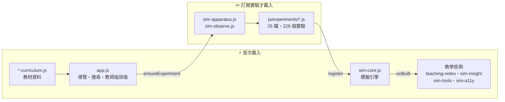

首次載入 gzip 約 236 KB；實驗程式開到才載入，Service Worker（`sw.js`）也只預先快取核心，實驗開到才快取。

### 📁 檔案結構

```text
senior-science/
├─ index.html            網站入口（首頁、自學版、教師演示版）
├─ duo/                  關卡挑戰版：index.html、duo.js、duo.css、embed.html（嵌入的實驗台）
├─ experiments.html      全部實驗索引（自動產生）
├─ vercel.json           部署設定與快取標頭
├─ DEPLOY.md             部署說明
├─ sw.js                 Service Worker
├─ manifest.json
├─ sitemap.xml / robots.txt      （自動產生）
├─ p/                    226 個實驗說明頁 + 226 份學習單（自動產生）
├─ css/style.css
├─ icons/
├─ docs/images/          README 用的截圖
├─ .github/workflows/deploy.yml  建置與測試檢查（不部署）
├─ tools/
│  ├─ build-manifest.js   產生實驗 → 檔案的對照表
│  ├─ build-static.js     產生靜態說明頁、學習單、sitemap、robots
│  ├─ verify-static.js    驗證靜態頁產出
│  ├─ stage-fit-check.js  教師版一頁不捲動的瀏覽器實測
│  └─ tests/              22 支自動化稽核
└─ js/
   ├─ site-config.js      正式網址、版本號
   ├─ app.js              導覽、搜尋、進度、主題、PWA
   ├─ sim-core.js         模擬引擎：UI、canvas、繪圖、graph、動畫迴圈、墨色層
   ├─ sim-insight.js      模型探測：量出真正的物理關係
   ├─ sim-tools.js        碼錶、量角器、尺
   ├─ sim-a11y.js         畫布的文字替代與 aria-live
   ├─ teaching-notes.js   各實驗的判讀、實驗流程與誤差鐵律
   ├─ experiment-manifest.js       實驗 → 檔案對照（自動產生）
   ├─ *-curriculum.js     教材資料（概念、公式、學習重點）
   ├─ question-bank.js    章節檢核與隨機化計算題
   └─ experiments/        26 個互動模擬註冊檔（226 個實驗分佈其中）
```

### 🔑 核心檔案說明

| 檔案 | 說明 |
| --- | --- |
| `js/site-config.js` | 正式網址、版本號。**改了 js/css 一定要更新版本號** |
| `js/sim-core.js` | 模擬引擎。UI 元件、canvas、繪圖、graph、動畫迴圈、時間控制列、主題感知的墨色層 |
| `js/sim-insight.js` | 探測引擎。掃描滑桿與讀數，用對數迴歸求出冪次關係並以中文陳述 |
| `js/teaching-notes.js` | 各實驗的判讀文案、實體實驗流程與誤差鐵律 |
| `js/experiments/*.js` | 互動模擬註冊檔。以 `PhysicsLab.register(id, def)` 註冊，id 必須與教材資料一致 |
| `tools/build-static.js` | 由課程資料產生靜態說明頁、學習單、sitemap 與 robots |
| `vercel.json` | 建置指令與快取標頭。`sw.js` 不快取、帶版本號的 js/css 快取一年 |
| `.github/workflows/deploy.yml` | 建置與測試檢查。**部署由 Vercel 負責，這裡不部署** |

---

## ⚙️ 模擬引擎概念

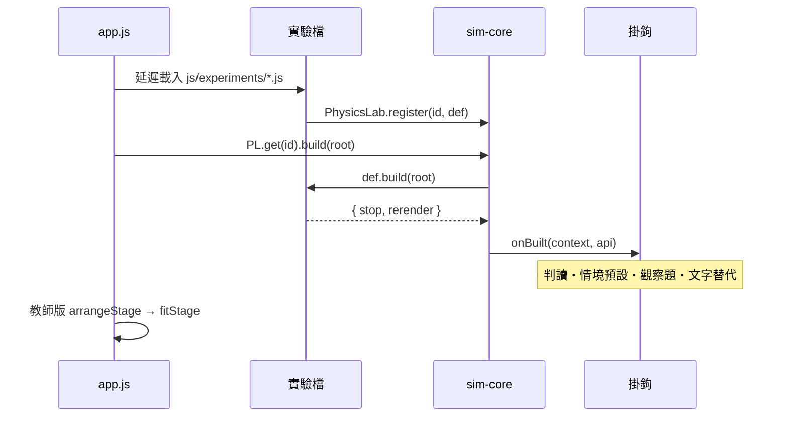

互動實驗透過 `PhysicsLab.register(id, definition)` 註冊：

```js
PhysicsLab.register("your-id", {
  build(root) {
    const L = PhysicsLab.ui.layout(root);
    const cv = PhysicsLab.canvas.create(L.canvasWrap, 0.6);

    const slider = PhysicsLab.ui.slider(L.controls, {
      label: "參數", min: 0, max: 10, value: 5, onInput: draw
    });
    const output = PhysicsLab.ui.readout(L.readouts, { label: "輸出", unit: "" });

    function draw() {
      cv.clear();
      PhysicsLab.draw.bg(cv);
      output.set(slider.get());
    }

    cv.onResize(draw);
    draw();
    return { stop() { cv.destroy(); }, rerender: draw };
  }
});
```

動態與直接操作（`sim-apparatus.js`）：

- `PhysicsLab.motion.clock(draw)`：給原本沒有時間軸的實驗一個時鐘，播放時每格呼叫 `draw(dt, t)`。
- `PhysicsLab.motion.flow(ctx, 折線, 已走距離, 選項)`：沿光路或導線流動的光點／電荷；`front: true` 只畫到波前。
- `PhysicsLab.motion.follower(初值, { omega, zeta })`：阻尼追隨器。參數改變後系統晃一晃再停在新平衡；暫停時直接跳到目標。
- `PhysicsLab.ui.handle(cv, { slider, label, toValue })`：畫布上的拖曳把手，在 `draw()` 裡呼叫 `handle.place(x, y)`。也可改傳 `onDrag`／`onRelease` 做「拉開再放手」。

注意：`onInput: draw` 會把滑桿值當第一個參數傳進去，`draw` 若有 `dt` 參數，要寫成 `onInput: () => draw()`。`transport-test` 會檢查全站沒有靜態實驗。

可用的教學元件：`ui.verdict`（判定徽章）、`ui.derived`（衍生量卡）、`ui.causality`（因果面板）、`ui.procedure`（實驗流程與鐵律）、`ui.presets`（情境預設）、`ui.chartTabs`、`ui.magnifier`。

### ⚠️ 兩條容易踩的引擎規則

**不要自己做播放／暫停按鈕。** 引擎的時間控制列已經提供播放、單步與速度，而且它控制的就是你的 `PhysicsLab.loop`。實驗若再維護一個自己的 `running` 旗標，就變成兩個開關要同時打開——傳輸列按了毫無反應，學生完全看不出問題在哪。單向觸發（「釋放」「開始」「發射」）則沒有問題。

**要被看見的東西用 `theme.pale()`，不要用 `theme.shade()`。** 這兩個是相反的：`pale()` 是與目前表面對比的墨色（深色主題給亮的、淺色給暗的），`shade()` 是比面板再凹一層的**表面**。拿 `shade()` 畫軌道、輪子、路面這種物件，對實驗台底板的對比只有 1.01——等於沒畫。

---

## ➕ 新增實驗流程

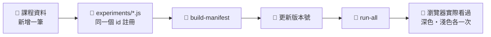

1. 在對應的課程資料檔新增一筆實驗資料，或呼叫 `PhysicsLabCurriculum.extendCatalog("來源名稱", { 模組ID: [實驗資料] })`。
2. 設定 `id`、`title`、`interactive`、`concept`、`formula`、`points`。
3. 在 `js/experiments/*.js` 用**同一個 id** 註冊模擬。
4. 執行 `node tools/build-manifest.js` 更新對照表（關卡挑戰版會自動多出這一關，題目由探測引擎量到的關係產生，不需另外寫）；新增 JS 檔要在 `index.html` 加 `<script>`，離線用的要同步更新 `sw.js` 的清單。
5. 更新 `js/site-config.js` 與 `sw.js` 的版本號（兩處必須一致）。
6. `node tools/tests/run-all.js`，然後**打開瀏覽器實際看過**。

---

## ☁️ 部署

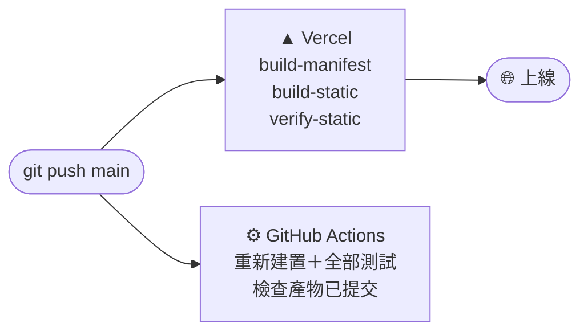

正式站在 **Vercel**，push 到 `main` 即自動部署。GitHub Pages 已停用。

快取策略、正式網址判定與自訂網域接法見 [DEPLOY.md](DEPLOY.md)。其中最要緊的一條：`sw.js` 必須設成不快取——Service Worker 自己就是管快取的人，它若被快取住，新版永遠裝不上去，使用者會卡在舊版而且沒有任何辦法自救。

---

<a id="license"></a>

## 📜 使用授權

原創教學內容與視覺素材採用 **CC BY-NC-SA 4.0**：可用於非商業教學、分享與改編，但須標示來源、連結授權並以相同方式分享。另提供科普推廣特別許可，老師、學生社團與創作者可以在公開文章、社群或含廣告分潤的平台中，以截圖、錄影與連結介紹本網站；不得把本站內容、鏡像站或改作包裝成付費服務。

完整條款見 [免費教育使用與推廣授權](https://senior-science.vercel.app/licensing.html) 與 [LICENSE.md](LICENSE.md)。

---

## 🎓 教學聲明

本站為配合台灣 108 課綱自製之開放教學工具。所有模擬程式與文字內容皆為原創。物理模型為教學簡化版，部分數值以概念示範為主，適合用於理解現象、探索趨勢與輔助學習，不作為精密工程或正式科學計算依據。
